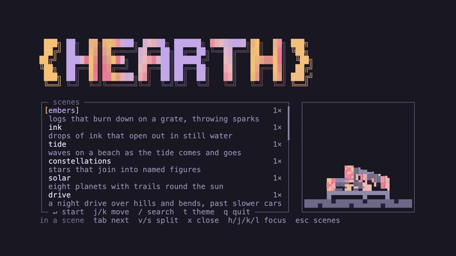

# ♨️ hearth

A terminal screensaver. One app, several scenes, a picker to choose from, and one key to walk through them.

The app draws about 60 frames a second. Most scenes draw in octant pixels, eight to a terminal cell, two across and four down, and blend the theme's colours where one shape meets the next. `matrix`, `bonsai` and `aquarium` keep the glyphs of the programs they follow, and `typing` draws text. Octants are Unicode 16 glyphs, so the terminal must draw them. Ghostty 1.3 does. A terminal that does not draws a fallback glyph in their place.



## Scenes

| Scene | After | What it draws |
|---|---|---|
| `embers` | | Logs on a grate over hearth stones glow at their ends and cracks and throw sparks that cool from gold to rose to grey as they rise. Each log burns down over a few minutes into coals, a new log drops onto the pile, and now and then a log settles with a burst |
| `ink` | | Drops of ink in love, iris, foam, pine and rose fall into still water, seen from the side. Each drop sinks and opens out, slow currents draw it into threads and curls that slide along the walls, and it thins by dither and fades over 20 to 40 seconds. A new drop falls every 5 to 12 seconds, never in the colour of the one before, and where two clouds meet they mix |
| `tide` | | A beach of gold sand with rose grains seen from above, with the sea along the bottom. Waves rush up the sand at a slant, stop at an uneven line of foam and drain away. The sand they leave is wet and dark and dries back over half a minute. Shells and pebbles lie where the sea reaches and hide when it returns, and over about four minutes the tide rises and falls |
| `constellations` | | A night sky of stars at three brightnesses that twinkle in place. Every 15 to 30 seconds four to six near stars join: a line one pixel wide draws itself from star to star, holds for about eight seconds under an invented name such as the kettle or the heron, and fades. Now and then a shooting star falls at a slant with a short gold trail |
| `solar` | | The sun and the eight planets, Mercury to Neptune, seen from above at a slant, with the orbits evened out so all eight fit. Each planet, a disc in its own colour lit on the side toward the sun, goes round its faint orbit at the pace that Kepler's third law gives, from about eight seconds for Mercury to a minute and a half for Neptune, and leaves a short trail that thins toward its end. The Moon goes round Earth, Saturn wears a flat ring, and Mercury passes in front of the sun and behind it |
| `drive` | | The view from behind a car on a night road. The road narrows to the horizon, bends left and right, and climbs and falls over long hills, so a crest hides the road beyond it. Edge stripes, centre dashes and posts rush toward the car over dark land. The car keeps to its lane on its own and leans into each bend, while the moon and the stars slide against the bend. Within seconds of the start, and then every so often, a slower car appears ahead in the other lane, grows as the car closes in, and drops behind |
| `city` | | A city at night, built for the pane: near and far towers with a rim on each roof, window grids and antennas with blinking lights, under stars and a moon. Windows light and go dark one by one as the night goes from evening to late and back over a few minutes. A lit train crosses on a raised line now and then, and the water below mirrors the towers dimly, each lit window a short streak that the ripples break |
| `river` | | The git history of the repository that `--repo` or the `repo` key names, or of the current directory, as a river seen from above. Each branch is a lane of water that splits off where the branch starts and joins where it merges, each commit is a stone, a merge in iris, and the commit at the middle row shows its subject beside its stone. The river runs between two sandy banks from the oldest of the last 500 commits to the newest, and starts again. Outside a repository it says so |
| `weather` | | The weather now at the place that `--latitude` and `--longitude` or the `[weather]` table give, over hills with pines and a cottage: the sun and birds by day, the moon and stars at night, clouds that drift in three layers, and bands of fog that slide past the hills. Rain falls at a slant under a bank of cloud, and the near drops splash where they land. Snow sways down in flakes, lies on the hills, the roof and the pines, and grows deeper in front over the first minute. A storm churns its clouds over a heavy rain, and every few seconds a bolt with a branch runs down to the hills and lights the sky twice. A strong wind draws the clouds out into fast streaks, sends waves through the grass, sways the pines, and blows leaves and curling gust lines across the land. The weather in words, the temperature and the place show above, with the credit to Open-Meteo under it. It reads the weather again every 15 minutes, on a thread of its own, and says so when it cannot. A read that fails after a good one keeps the sky and the last weather on screen, with its age and the reason, until the next good read |
| `matrix` | [cmatrix](https://github.com/abishekvashok/cmatrix) by Chris Allegretta | Columns of half-width katakana and capitals fall at their own pace, a bright head and a tail that fades from foam to pine |
| `fire` | [the PSX Doom fire](https://fabiensanglard.net/doom_fire_psx/), via Fabien Sanglard | The doom fire: heat rises from a white-hot base through gold, rose, love and a grey smoke and dies into the background, in the theme's colours only, blended where one meets the next |
| `life` | [John Conway's Game of Life](https://en.wikipedia.org/wiki/Conway%27s_Game_of_Life) | Conway's game of life on a torus, a cell of the game to a pixel, a cell drawn in rose where most of its cells were just born and in iris where they have settled, reseeded when the board goes still |
| `pipes` | [pipes.sh](https://github.com/pipeseroni/pipes.sh) by Matthew Simpson | A few pipes one pixel wide, each with a thin highlight, walk and turn, each in a colour no other pipe has, wrap at the edges and take a new colour there, and the screen clears once most of it is drawn |
| `bonsai` | [cbonsai](https://gitlab.com/jallbrit/cbonsai) by John Allbritten | The cbonsai tree grows step by step from a pot, gold wood and leaves in pine and foam, then holds and a new one grows |
| `aquarium` | [asciiquarium](https://robobunny.com/projects/asciiquarium/html/) by Kirk Baucom | Fish in three sizes swim at their own pace and depth, let out bubbles that rise to the waterline, over swaying seaweed |
| `murmuration` | [the boids](https://www.red3d.com/cwr/boids/) of Craig Reynolds | A flock of starlings folds, stretches, splits and joins in a dusk sky that lightens over a line of trees. The dense core of the flock is bright and its edges fade. Every 30 to 60 seconds a hawk crosses once, and the flock opens around it |
| `hourglass` | [the Pomodoro Technique](https://en.wikipedia.org/wiki/Pomodoro_Technique) of Francesco Cirillo | An hourglass of two smooth bulbs and a narrow neck in a pine frame keeps a Pomodoro cycle on the real clock: by default a work round of 25 minutes in gold sand, a break of 5 in foam, and a long break of 15 after the fourth round. The sand falls grain by grain through the neck and piles at its natural slope, and the top empties as the phase ends. Then the glass turns over and the next phase starts. Four marks beside the glass count the rounds. A line over the glass names the phase and the time left, such as "work 2/4 · 18:32 left", and a narrow pane shows the time alone. A line under the glass names the timer's keys, and a narrow pane drops keys from the end until the line fits. Space pauses the timer: the time and every grain stop, the line over the glass ends with "paused", and space again goes on from there. `n` turns the glass over to the next phase with all its time left. `+` adds a minute to the running phase and `-` takes one away, and with a minute or less left `-` goes to the next phase. Neither changes the lengths in the file. `e` opens a small box over the glass that sets the lengths: `j` and `k` pick work, the break or the long break, `+` and `-` change it by a minute from 1 to 180, Enter saves all three to `[hourglass]` and keeps the file's comments, and Esc leaves the box with nothing saved. The phase that runs keeps its length, and each phase after it takes the new one. The cycle starts when the scene does |
| `study` | the lofi study streams | A desk by a rainy window at night, drawn by hand, a character to a pixel: books, a lamp, a mug and a computer on the desk, and a cat on the sill against the lights of a town. Rain runs down the glass, steam rises from the mug, the lamp flickers and lights the wall, the cat flicks its tail now and then, and the screen types and scrolls. On a small pane only the window shows |
| `typing` | [gittype](https://github.com/unhappychoice/gittype) by Yuji Ueki | Types one function at a time from a random file of a git repository, the way a person would, with a cursor and a pause at each line, at a speed you set, coloured by the grammar of each file's language, in a centred frame with line numbers, under a breadcrumb of the file's path and function and over a status line of the language, the cursor's line and column, and the speed, between a file tree open to the current file and a minimap of the whole file |
| `noise` | | Soft static over the whole terminal: clouds of noise, shaded from the background to the text, drift and change shape as they move |

`hearth --help` lists every scene the build carries.

## Install

On macOS, with Homebrew:

```sh
brew install gf6599/tap/hearth
```

Each [release](https://github.com/GF6599/hearth/releases) also carries archives for macOS and Linux, on Intel and ARM.

From a clone, with the Rust toolchain that `rust-version` in `Cargo.toml` names, or a later one:

```sh
cargo install --path .
```

Or build and copy the binary to `~/self-made-bin/`:

```sh
just ship
```

A short alias saves typing when the app runs as a screensaver:

```sh
alias hth=hearth
```

## Usage

```sh
hearth              # open the picker
hearth tide         # start one scene
hearth --seed 7     # replay the same frames
```

`--seed <n>` fixes the random source, so two runs with the same seed draw the same frames and the same chain of restarts. Without it, the clock seeds each run.

Every scene keeps its own speed. `+` and `-` change the speed of the scene on screen, and the new value shows in the corner for a second. Typing steps in keystrokes per second, from 1 to 1000, and starts at 50. The other scenes step through ¼×, ½×, ¾×, 1×, 1.5×, 2×, 3× and 4×. A restart, Tab and the picker keep each scene's speed, and the config file keeps it between runs.

The typing scene types hearth's own source unless `--repo` names another repository, and the river draws the history of that repository, or of the current directory:

```sh
hearth typing --repo ~/code/some-project      # a checkout on disk
hearth typing --repo rust-lang/rust           # a GitHub repository
hearth typing --repo https://example.com/x.git
```

The weather scene shows the weather at a place given in degrees north and east, south and west as negative numbers:

```sh
hearth weather --latitude 59.91 --longitude 10.75
```

The flags come before the `[weather]` table of the config file, and each needs the other. Without a place, the scene says how to give one.

A GitHub repository or a clone address is cloned once, with its last 500 commits, into `~/.cache/hearth` (or `$XDG_CACHE_HOME/hearth`), with one line on stderr before the terminal opens. Every later run reads the cache, so the scene starts without a network. Only tracked text files under 64 KiB are read, so an ignored or untracked file never shows. A repository with no function in any of them is refused at startup.

### Config file

hearth reads `~/.config/hearth/config.toml` (or `$XDG_CONFIG_HOME/hearth/config.toml`) at startup. Every key is optional, and a missing file gives the defaults:

```toml
scene = "fire"            # the scene a bare `hearth` starts. Absent: the picker
repo = "rust-lang/rust"   # what the typing scene types and the river draws. Absent: hearth's own source, and the history of the current directory
theme = "rose-pine-dawn"  # rose-pine, rose-pine-moon, rose-pine-dawn, catppuccin-mocha, catppuccin-latte, tokyo-night, tokyo-night-day, kanagawa-wave, kanagawa-lotus, dracula, dracula-alucard, solarized-dark or solarized-light. Absent: rose-pine
background = "terminal"   # theme or terminal. Absent: theme
sound = false             # true or false. Absent: true
volume = 60               # percent, from 0 to 100 in steps of 10. Absent: 100

[speed]
typing = 50     # keystrokes per second, from 1 to 1000
fire = 1.5      # times the normal pace: 0.25, 0.5, 0.75, 1, 1.5, 2, 3 or 4

[hourglass]
work = 50       # minutes, from 1 to 180. Also break and long_break. Absent: 25, 5 and 15

[typing]
shortest = 0.25 # the share of the frame a function must fill, from 0 to 1. 0 types every function. Absent: 0.5

[weather]
latitude = 59.91   # degrees north, from -90 to 90. Give both or neither. Absent: no place
longitude = 10.75  # degrees east, from -180 to 180
```

The theme colours every scene and the picker. `t` moves to the next theme, starts each scene again in its colours, and saves the theme to the file the way `+` and `-` save a speed. The hourglass changes its colours only, so its phase, its time left and a pause hold. Dawn, Latte, Tokyo Night Day, Kanagawa Lotus, Alucard and Solarized Light are light themes, so their fire grows from the gold role and not from white. `background = "terminal"` leaves out the theme's base colour, its panels and the murmuration dusk, so the terminal's own background shows behind every scene and the picker, and a transparent or translucent terminal stays so. The other colours stay as the theme draws them, the grey of the fire's smoke included. The typing scene's minimap draws each line as one row of pixels with a clear row under it, so the terminal shows between them, and dims the lines not yet typed toward the muted grey, because a mix toward the hidden base reads as a dark shade. A scene or `--repo` on the command line comes before the file. `+` and `-` save the new speed to the file at once and keep its comments. A save that fails shows in the notice, and the speed still holds for the run. The hourglass keeps real time, so `[speed]` has no key for it, and on the hourglass `+` and `-` change the running phase by a minute and save nothing. The typing scene skips a function with fewer lines than `shortest` times the rows of code its frame holds, so the limit follows the size of the terminal. A function of 40 lines or more, which the scene cuts at 40, is always long enough. A file with no function long enough gives way to the next file, and when no file in the repository has one, the scene types the longest function each time. A repository with more than 32 KB of text is measured on a thread of its own, so the screen does not wait for it. Until the first function long enough is found, the frame shows "finding a function long enough". A finished function stays on screen for a moment, then scrolls up and out of the frame in under a second at any speed, slowly at first and at last. When the next function is not found yet, the frame stays empty until it is. A key hearth does not know, or a value outside its range, stops startup with a message that names the file and the key.

### Picker

The picker lists each scene with a one-line summary and the speed it starts at, under the `{hearth}` mark, whose letters glow in drifting patches like embers, from iris through rose and love to gold. The heat climbs each letter from its lower rows, the shadow under the letters glows dimmer, and the gold braces take a faint warmth from the letters beside them. The marked scene runs in a pane beside the list, at its own speed, from its first frame. The list and the pane are one height. The pane's bottom rule names the work and the person whose idea the scene reuses, whole or not at all. A narrow terminal drops the pane and shows the mark as the braced word. When the scenes do not all fit, the list scrolls with the mark and a thumb on its right rule shows where it is. A short terminal drops the mark when fewer than five scenes would stay in view, and then the summaries. Under the list, one line names the keys of a running scene, the split keys among them, whole or not at all. In a search every letter types, the arrows, `Tab` and `Shift-Tab` move among the matches, and the list shows the scenes whose name holds the typed letters in order, then those whose summary holds them as one run.

| Key | Action |
|---|---|
| `j` / `k` | Move down and up the list, also `Down` / `Up` |
| `Tab` / `Shift-Tab` | Mark the next or the previous scene, round the list |
| `Enter` | Start the marked scene |
| `/` | Search the list: type to narrow it, `Backspace` to erase, `Esc` to show the whole list again |
| `Esc` | Close the pane, when a split just opened it |
| `t` | Next colour theme |
| `q` / `Ctrl-c` | Quit |

### Scene

| Key | Action |
|---|---|
| `Tab` / `Shift-Tab` | Next or previous scene, round the list |
| `r` | Restart the scene with a new seed |
| `+` / `-` | Run the scene on screen faster or slower. On the hourglass, add a minute to the running phase or take one away |
| `Esc` | Back to the picker |
| `v` / `s` | Split the pane side by side or stacked |
| `x` | Close the pane |
| `h` `j` `k` `l` | Move to the pane on that side, also the arrows |
| `t` | Next colour theme |
| `m` | Turn the sound off or on |
| `[` / `]` | Make the sound quieter or louder by 10% |
| `Space` | Pause or resume the hourglass timer |
| `n` | Go to the next phase of the hourglass |
| `e` | Set the hourglass lengths in a box: `j` / `k` pick, `+` / `-` change, `Enter` saves, `Esc` leaves |
| `q` / `Ctrl-c` | Quit |

### Sound

While the typing scene types, it plays a recording of a mechanical keyboard at a person's own pace, so the sound stays calm at any typing speed. The sound carries over the pause at the end of a line and fades out while a function holds and scrolls away. The recording is "Custom Mechanical Keyboard" by tofu_delivery on [Freesound](https://freesound.org/people/tofu_delivery/sounds/588650/), in the public domain (CC0). The fire scene plays a binaural recording of a crackling fire, which sounds best on headphones: "(binaural) fire crackling" by yfjesse on [Freesound](https://freesound.org/people/yfjesse/sounds/734248/), also CC0. The river plays "Small River 1 - Slow - Semi close" by Pfannkuchn on [Freesound](https://freesound.org/people/Pfannkuchn/sounds/459412/), and the tide plays "Waves on the beach (close to the sand) - Rémire-Montjoly, French Guiana" by felix.blume on [Freesound](https://freesound.org/people/felix.blume/sounds/868874/), both CC0. The tide's sound rises as a wave runs up the sand and falls as it draws back. The weather scene plays the weather it shows, and when the weather changes, one sound fades into the next. A roll of thunder follows each bolt of a storm, a far foghorn sounds now and then in the fog, and the wind grows louder and quieter with its gust lines. The table below credits its ten recordings, all CC0. `just sounds` cuts every recording again from its source. With split panes, only the focused pane plays, and a focus move fades one sound out and the next one in. Sound is on until `m` turns it off, and `m` saves the choice to the config file the way `t` saves the theme. `[` and `]` set the volume from 0% to 100% on top of the system volume and save it the same way, and `m` keeps the volume for when the sound comes back. Sound plays on macOS. On Linux, or with no output device, hearth runs silent and the notice says why.

| Weather | Sound | Recording on Freesound |
|---|---|---|
| Clear, by day | Birdsong in a meadow | ["Meadow.wav" by PuzzleAudio](https://freesound.org/people/PuzzleAudio/sounds/440807/) |
| Clear, at night | Crickets | ["Crickets At Night - Raw sound" by Defelozedd94](https://freesound.org/people/Defelozedd94/sounds/522299/) |
| Cloud | A steady breeze in a forest | ["forest_ambience_steady_breeze_summer_sweden_leaves_light_wind_distant_highway_loop_m10.wav" by johanwestling](https://freesound.org/people/johanwestling/sounds/460178/) |
| Rain | Soft rain on leaves | ["Soft Rain in Forest Raindrops fall on leaves" by Borgory](https://freesound.org/people/Borgory/sounds/678435/) |
| Snow | A cold wind | ["Wind\_\_Artic\_\_Cold.wav" by cobratronik](https://freesound.org/people/cobratronik/sounds/117136/) |
| Storm | Heavy rain | ["Thunderstorm with heavy rain1.wav" by Audeption](https://freesound.org/people/Audeption/sounds/425174/) |
| A bolt in a storm | A roll of thunder | ["Distant Thunder Clap_Gentle.wav" by mikala_oidua](https://freesound.org/people/mikala_oidua/sounds/347562/) |
| Fog | Water that drips in a cave | ["Water Cave" by Klangkobold](https://freesound.org/people/Klangkobold/sounds/443061/) |
| Now and then in the fog | A far foghorn over the sea | ["Ocean and Fog Horn.wav" by shepardr](https://freesound.org/people/shepardr/sounds/128093/) |
| Wind | Wind in the trees | ["wind in the trees" by deleted_user_229898](https://freesound.org/people/deleted_user_229898/sounds/150174/) |

### Panes

The screen splits the way i3 does. `v` or `s` cuts the focused pane in two, and the new half opens the picker, with the scene after the focused one marked. `Esc` in that picker takes the split back. A thin rule separates the panes, and gold marks at two corners show the focused one. `Tab`, `Shift-Tab`, `r`, `+`, `-` and `Esc` act on the focused pane only, and every other pane runs on. `x` gives a pane's area to the other half of its split. The last pane stays. Each split stays at half and half when the terminal changes size.

## Development

```sh
just          # list every recipe
just tools    # install cargo-deny once, at the version the gate uses
just check    # the quality gate: clippy, the tests, cargo deny, then a format check
just demo     # record doc/demo.gif with vhs
```

Every scene is a module under `src/scenes/` that implements the `Scene` trait: `tick` advances one tick and `render` draws it. The app draws four frames a tick, about 60 frames a second, and a scene at 1× ticks once every four frames. A scene can glide between two ticks with `set_progress`, which gives it the share of the next tick it has run. The typing scene ticks once a frame. A scene takes its random source from the seed, so a test can assert one exact frame.

## License

MIT.

The weather comes from [Open-Meteo](https://open-meteo.com/), whose data is under [CC BY 4.0](https://creativecommons.org/licenses/by/4.0/). Its free service is for non-commercial use.
