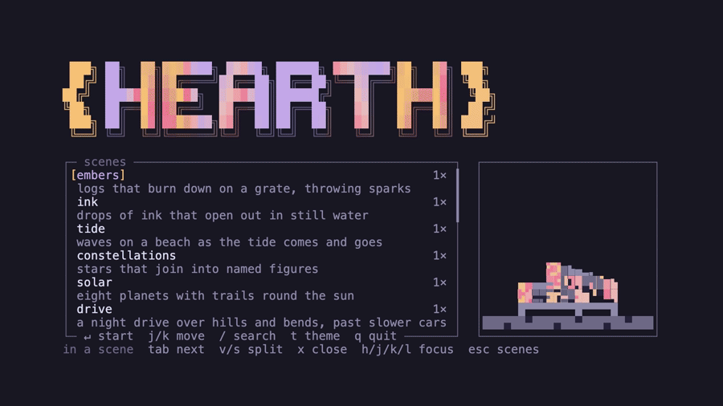

# ♨️ hearth

A terminal screensaver. One app, several scenes, a picker to choose from, and one key to walk through them.



## Scenes

| Scene | What it draws |
|---|---|
| `noise` | Random glyphs over the whole terminal, a placeholder that proves the loop |

`hearth --help` lists every scene the build carries.

## Install

With a Rust toolchain, 1.85 or later, because the crate uses the 2024 edition:

```sh
cargo install --path .
```

Or build and copy the binary to `~/self-made-bin/`:

```sh
just ship
```

A short alias saves typing when the app runs as a screensaver:

```sh
alias hth=hearth
```

## Usage

```sh
hearth              # open the picker
hearth noise        # start one scene
hearth --seed 7     # replay the same frames
```

`--seed <n>` fixes the random source, so two runs with the same seed draw the same frames and the same chain of restarts. Without it, the clock seeds each run.

### Picker

| Key | Action |
|---|---|
| `j` / `k` | Move down and up the list, also `Down` / `Up` |
| `Enter` | Start the marked scene |
| `q` / `Ctrl-c` | Quit |

### Scene

| Key | Action |
|---|---|
| `Tab` | Next scene |
| `r` | Restart the scene with a new seed |
| `Esc` | Back to the picker |
| `q` / `Ctrl-c` | Quit |

## Development

```sh
just          # list every recipe
just tools    # install cargo-deny once, at the version the gate uses
just check    # the quality gate: clippy, the tests, cargo deny, then a format check
just demo     # record doc/demo.gif with vhs
```

Every scene is a module under `src/scenes/` that implements the `Scene` trait: `tick` advances one frame and `render` draws it. A scene takes its random source from the seed, so a test can assert one exact frame.

## License

MIT.
